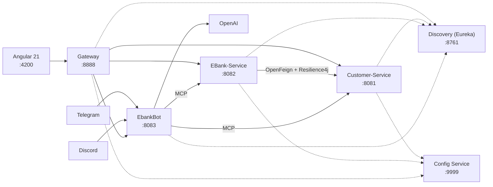

# E-Bank Microservices — Architecture microservices et agentique

Projet pratique du cours **Architecture Microservices et Agentique** (Pr. Mohamed Youssfi).

Une banque en ligne découpée en microservices **Spring Cloud**, pilotée par un **agent IA** (Spring AI + MCP) accessible depuis une application **Angular 21**, Telegram et Discord, et déployable avec **Docker Compose**.

## Architecture



## Services

| Service | Port | Rôle |
|---|---|---|
| `discovery-service` | 8761 | Annuaire des services (Eureka) |
| `config-service` | 9999 | Configuration centralisée (profil `native`) |
| `customer-service` | 8081 | Gestion des clients (API REST, Swagger-UI, outils MCP) |
| `ebank-service` | 8082 | Gestion des comptes (API REST, OpenFeign, Circuit Breaker, outils MCP) |
| `gateway-service` | 8888 | Point d'entrée unique, routage dynamique via Eureka, CORS |
| `ebank-bot` | 8083 | Agent IA (Spring AI, OpenAI, mémoire de conversation, client MCP, Telegram, Discord) |
| `ebank-frontend` | 4200 | Application Angular 21 |

## Technologies

- **Backend** : Java 17, Spring Boot 4.1, Spring Cloud (Eureka, Config, Gateway, OpenFeign), Resilience4j, Spring Data JPA, H2, springdoc (Swagger-UI)
- **IA** : Spring AI, OpenAI, Model Context Protocol (MCP, transport Streamable HTTP)
- **Frontend** : Angular 21 (signals, Signal Forms, intercepteur HTTP, streaming, rendu Markdown)
- **Clients de chat** : Telegram (API Bot), Discord (JDA)
- **Déploiement** : Docker, Docker Compose

## Fonctionnalités

- Communication synchrone entre services avec **OpenFeign** et tolérance aux pannes avec un **Circuit Breaker** (réponse de repli si le Customer-Service est indisponible)
- Routage dynamique des requêtes avec la **Gateway** et **Eureka**
- Configuration centralisée avec le **Config Service**
- Outils MCP exposés par les microservices (`get_all_customers`, `get_customer_by_id`, `create_customer`, `get_all_accounts`, `get_account_by_id`, `get_accounts_by_customer`, `create_account`)
- Agent IA limité aux opérations bancaires par un prompt système, avec mémoire de conversation
- Interface Angular : liste des comptes, formulaire de création (Signal Forms), spinner de chargement, chat avec réponses en streaming
- Le même agent répond sur le web, Telegram et Discord

## Lancement avec Docker (recommandé)

Prérequis : Docker Desktop et une clé API OpenAI.

1. Cloner le dépôt :

   ```bash
   git clone https://github.com/Abdallah2501/ebank-microservices.git
   cd ebank-microservices
   ```

2. Créer le fichier `.env` à la racine, à partir de `.env.example` :

   ```
   OPENAI_API_KEY=votre_cle_openai
   TELEGRAM_BOT_TOKEN=
   DISCORD_BOT_TOKEN=
   ```

   Les tokens Telegram et Discord sont optionnels : sans eux, ces deux clients sont simplement désactivés.

3. Construire et démarrer :

   ```bash
   docker compose up --build
   ```

   Le premier démarrage prend quelques minutes. Certains services redémarrent tant que le Config Service n'est pas prêt, c'est normal.

4. Ouvrir :
   - Application : http://localhost:4200
   - Eureka : http://localhost:8761
   - API via la Gateway : http://localhost:8888/customer-service/api/customers

5. Arrêter :

   ```bash
   docker compose down
   ```

## Lancement en local (sans Docker)

Prérequis : JDK 17, Node.js 22 (ou 20.19+), Angular CLI.

Démarrer dans cet ordre, en attendant que chaque service soit prêt :

1. `discovery-service`
2. `config-service`
3. `customer-service` et `ebank-service`
4. `gateway-service`
5. `ebank-bot` (avec la variable d'environnement `OPENAI_API_KEY`)
6. Frontend :

   ```bash
   cd ebank-frontend
   npm install
   ng serve
   ```

Le bot se connecte aux serveurs MCP au démarrage : il doit être lancé après `customer-service` et `ebank-service`, et redémarré si l'un d'eux est relancé.

## URLs utiles

| Ressource | URL |
|---|---|
| Swagger-UI Customer-Service | http://localhost:8081/swagger-ui.html |
| Swagger-UI EBank-Service | http://localhost:8082/swagger-ui.html |
| Serveur MCP Customer-Service | http://localhost:8081/mcp |
| Serveur MCP EBank-Service | http://localhost:8082/mcp |
| Chat (REST) | http://localhost:8083/chat?question=Liste tous les clients |
| Chat (streaming via la Gateway) | http://localhost:8888/ebank-bot/chat/stream?question=Liste tous les clients |

## Exemples de questions pour le chatbot

- `Liste tous les clients`
- `Quels sont les comptes du client 1 ?`
- `Crée un client Karim avec l'email karim@gmail.com`
- `Crée un compte épargne de 5000 MAD pour le client 4`

## Tests

- Les endpoints REST se testent avec Postman ou Swagger-UI.
- Les outils MCP se testent avec le **MCP Inspector** :

  ```bash
  npx @modelcontextprotocol/inspector
  ```

  Transport *Streamable HTTP*, URL `http://localhost:8081/mcp` puis `http://localhost:8082/mcp`.

## Captures d'écran

<!-- Ajouter vos captures dans docs/screenshots/ puis décommenter -->
<!--


-->

## Notes

- Les bases **H2 sont en mémoire** : les données sont recréées à chaque démarrage des services.
- Les secrets (clé OpenAI, tokens Telegram et Discord) ne sont jamais versionnés : ils sont lus depuis des variables d'environnement ou depuis le fichier `.env`, exclu du dépôt.
- Dans Docker, les services se joignent par leur nom (`discovery-service`, `config-service`, ...) grâce à des variables d'environnement définies dans `docker-compose.yml`.

## Pistes d'amélioration

- Sécurité avec Keycloak
- Bases de données persistantes (PostgreSQL)
- Tests automatisés
- Pipeline CI/CD

## Auteur

**Abdallah Bencherki**

- GitHub : [Abdallah2501](https://github.com/Abdallah2501)
- LinkedIn : [abdallah-bencherki](https://www.linkedin.com/in/abdallah-bencherki-231379345/)
